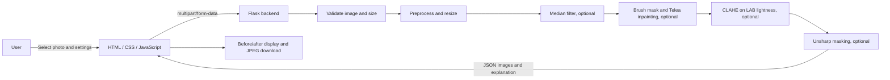

# RetroFix — Old Photo Restoration System

## Cover page

**Project:** RetroFix — Old Photo Restoration System  
**Course:** BCI515D — Image and Video Processing  
**Programme:** B.E. / B.Tech. (VTU), 5th Semester  
**Student:** ____________________  
**USN:** ____________________  
**Guide:** ____________________  
**Department / College:** ____________________  
**Academic year:** ____________________

## Abstract

Old photographs may contain noise, faded contrast, scratches, blotches, and paper creases. RetroFix is a local web application that demonstrates traditional digital image processing methods for improving such photographs. A browser interface built with HTML, CSS, and JavaScript communicates with a Python Flask backend. OpenCV and NumPy perform median filtering, mask-based inpainting, CLAHE contrast enhancement, and unsharp-mask sharpening. The user uploads an image, selects restoration settings, and paints over damaged areas to create a repair mask. The system displays the original and processed images side by side and allows the result to be downloaded. The project uses no machine-learning model or paid service. It demonstrates image enhancement, restoration, noise removal, and blotch/scratch removal techniques from the BCI515D syllabus.

## 1. Introduction

Photographs are affected by dust, scratches, stains, aging, and physical creases. These defects reduce visual quality and can hide important details. Digital image processing provides practical methods to reduce noise, improve contrast, sharpen details, and fill selected damaged regions. RetroFix presents these methods through a beginner-friendly local application.

## 2. Problem statement

A user needs a simple way to prepare an old photograph, reduce common noise and contrast problems, manually select physical damage, view the result, and save a restored copy. The project must run locally and use explainable, traditional image-processing algorithms.

## 3. Objectives

- Build a local web interface for JPG, JPEG, and PNG photographs.
- Resize large images while maintaining aspect ratio.
- Reduce impulse-like noise with median filtering.
- Let the user mark scratches, blotches, and paper creases with a brush.
- Fill the marked mask with OpenCV inpainting.
- Improve local contrast using CLAHE in the LAB color space.
- Sharpen the output with unsharp masking.
- Show a before/after comparison and download the result.
- Explain the processing stages in language suitable for a student demonstration.

## 4. Scope and constraints

The application processes one still image at a time in the local Flask server. It supports manual selection of damage and traditional algorithms only. Uploaded files are processed in memory and are not retained on disk. The app does not automatically detect damage, reconstruct large missing objects, colorize monochrome photographs, or use machine learning. Classical inpainting estimates a marked area from nearby pixels; results can be soft when the damaged region is large or contains important detail.

## 5. Tools and requirements

| Tool | Use |
|---|---|
| Python | Backend and processing logic |
| Flask | Local web server and upload endpoints |
| OpenCV | Filtering, color conversion, CLAHE, and inpainting |
| NumPy | Image arrays and binary damage masks |
| Pillow | Image decoding and format conversion |
| HTML | Page structure |
| CSS | Layout, responsive styling, and light/dark themes |
| JavaScript | File preview, brush interaction, settings, and downloads |

All listed libraries are free to use. The exact installed versions are recorded by the user's Python environment; `requirements.txt` lists the project dependencies.

## 6. System architecture



## 7. Methodology and algorithms

### 7.1 Preprocessing

The uploaded file is decoded with Pillow and converted to RGB. Images whose longest dimension is above 1600 pixels are downscaled while preserving their aspect ratio. This bounds processing time and canvas size. The RGB image is converted to LAB and back to demonstrate the separation of lightness from color; this round trip alone is not an enhancement.

### 7.2 Median noise removal

For each pixel, a square neighborhood is examined and its median value is used. The median filter is effective for isolated impulse-like noise and generally preserves edges better than a simple averaging filter. The interface allows 3×3, 5×5, and 7×7 windows. A larger window removes stronger noise but can soften small details.

### 7.3 Manual scratch mask and inpainting

The user paints over scratches, stains, and paper creases. JavaScript records the strokes on a transparent canvas. The backend converts nontransparent/magenta pixels into a binary mask, expands the mask slightly, and calls `cv2.inpaint` with the Telea fast-marching method. The inpainting radius controls the neighborhood used to estimate missing pixels. The user must mark the damaged areas; the app does not automatically detect them.

### 7.4 CLAHE contrast enhancement

The image is converted to LAB. CLAHE (Contrast Limited Adaptive Histogram Equalization) is applied to the L (lightness) channel, while A and B color channels are retained. The channels are then merged and converted back to RGB. The 8×8 tile grid and clip-limit setting improve local contrast while limiting excessive amplification.

### 7.5 Unsharp-mask sharpening

A Gaussian-blurred copy is subtracted from the image to emphasize high-frequency detail, then combined with the original:

`Sharpened = (1 + amount) × Original − amount × GaussianBlur(Original)`

The amount control adjusts sharpening strength. Excessive sharpening can emphasize noise and create halos, so the result should be visually checked.

### 7.6 Overall processing order

1. Decode, validate, convert to RGB, and resize if necessary.
2. Apply median filtering if selected.
3. Repair the user-marked mask using Telea inpainting if marks exist.
4. Apply CLAHE if selected.
5. Apply unsharp masking if selected.
6. Encode the result, show comparisons, and provide a JPEG download.

### Pseudocode

```text
INPUT image, brush mask, selected settings
image ← decode as RGB
image ← resize if longest side exceeds 1600 pixels
IF median enabled: image ← median filter(image, kernel)
IF brush mask is nonempty: image ← Telea inpaint(image, mask, radius)
IF CLAHE enabled: image ← CLAHE(L channel in LAB(image))
IF sharpening enabled: image ← unsharp mask(image, amount)
DISPLAY original and result
ALLOW result download
```

## 8. BCI515D module mapping

| Syllabus area | RetroFix demonstration |
|---|---|
| Module 2: image enhancement, histogram equalization, filtering | CLAHE on LAB lightness; median and Gaussian filtering; unsharp masking |
| Module 3: image restoration and noise removal | Median noise reduction and mask-based restoration |
| Module 5: blotch and scratch removal | User-drawn mask and OpenCV Telea inpainting |

## 9. Expected results

The interface should accept supported photographs and show previews. Median filtering should reduce small speckle noise. CLAHE should improve local contrast. Unsharp masking should make edges crisper. Inpainting should reduce small defects covered by the brush mask. The result depends on the image and user settings; large creases or missing regions may remain soft. The app reports the selected methods and returns a downloadable JPEG.

## 10. Testing

Follow [the manual testing guide](TESTING_GUIDE.md). Use a clean portrait and a copy with manually added thin marks to compare filters and inpainting. Check file validation, image dimensions, processing controls, brush masks, download, and both themes. Do not claim a numeric quality improvement unless it has been measured on a defined test set.

## 11. Limitations and future scope

- Damage selection is manual; automatic scratch detection is not included.
- Inpainting uses neighboring information and cannot recover unknown original detail.
- Wide folds, faces crossing a crease, or large missing areas can produce blur.
- Median filtering may soften fine texture; sharpening may amplify noise.
- Future work could add an undoable brush, selectable Telea/Navier–Stokes methods, histogram plots, and quantitative measures such as PSNR/SSIM when a reference image is available.

## 12. Conclusion

RetroFix combines traditional image-processing techniques in a local, easy-to-demonstrate interface. It connects BCI515D concepts to a practical workflow: filtering reduces noise, a manually selected mask guides inpainting, CLAHE improves local contrast, and unsharp masking improves perceived sharpness. The system remains transparent about each operation and about the limitations of reconstructing damaged image regions without learned models.

## References

1. OpenCV, “Image Filtering,” including `medianBlur` and `GaussianBlur`: https://docs.opencv.org/4.0.0-alpha/d4/d86/group__imgproc__filter.html
2. OpenCV, “Histogram Equalization / CLAHE”: https://docs.opencv.org/4.12.0/d5/daf/tutorial_py_histogram_equalization.html
3. OpenCV, “Operations on arrays / addWeighted”: https://docs.opencv.org/4.0.0/d2/de8/group__core__array.html
4. Flask, “Uploading Files”: https://flask.palletsprojects.com/en/stable/patterns/fileuploads/
5. Wikimedia Commons sample image licensing pages: see `../sample_images/README.md`.
